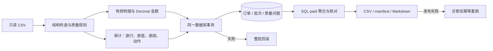

# E-Commerce Order Pipeline

一个单机订单 ETL：读取 CSV，隔离有问题的行，用整数分计算金额，在一个事务里写入数据库，再用 SQL 对账并输出报告。支持 SQLite 和 MySQL。

它想说明的是批处理里的几件基本功：脏数据怎么处理、金额怎么不丢精度、失败了怎么回滚、重跑为什么不会产生重复数据。

这个项目是在 AI（Codex）辅助下完成的，来源和与原学习仓库的区别见 [PROVENANCE](docs/PROVENANCE.md)。

## 快速运行

需要 Python 3.12，不需要 MySQL 或 Docker：

```bash
python3.12 -m venv .venv
.venv/bin/python -m pip install -r requirements.txt -c constraints-demo-py312.txt
.venv/bin/python -m scripts.demo_sqlite
```

脚本会建一个全新的 SQLite 库，跑完整流程（入库、重跑、分析、重建报告），并核对产物哈希、SQL 金额和三张表的行数。成功时最后一行是：

```text
演示通过：30 = 26 + 3 + 1；paid 66.00 元；重跑、SQL、输入保护一致。
```

报告生成在 `.local/demos/sqlite-*/run/report.md`，一份样例见 [sample-report.md](docs/sample-report.md)。

演示数据是 30 行虚构订单（生成方式见 [data/README.md](data/README.md)，字段定义见[数据字典](docs/ARCHITECTURE.md#八字段数据字典)）：26 行被接收，3 行因质量问题被隔离，1 行是重复副本，其中 11 笔 `paid` 订单合计 66.00 元。

## 处理流程



**质量规则**
- 完全相同的重复行保留第一条；订单号相同但内容冲突的，整组隔离。
- 数量、单价、状态不合法的行隔离。城市为空补“未知”；日期无效则留空，订单金额仍然计入。

**金额**
- 单价用 `Decimal` 计算，数据库里存整数分（MySQL 用 BIGINT），只统计 `paid` 订单。
- 每次运行输出两个口径：Pandas 的本批汇总，和 SQL 的全库汇总。多批次入库后两者会不同，这是预期行为。

**事务与重跑**
- 唯一键是 `order_id`。重跑时比较库里的当前字段，没变的不写，所以 A → B → A 的数据变化也能恢复。
- 订单、批次、质量问题三张表在同一事务里提交。数据库提交和报告文件发布是两个步骤，发布失败后重跑即可补齐。

更多细节：[架构与三表设计](docs/ARCHITECTURE.md) · [运行、MySQL 与 Docker](docs/RUNNING.md)

## 测试

```bash
.venv/bin/python -m pip install -r requirements-dev.txt -c constraints-demo-py312.txt
.venv/bin/python -m pytest tests/v1 -q
.venv/bin/python -m ruff check src/order_pipeline scripts tests/v1
.venv/bin/python -m scripts.check_release
```

当前共 129 项测试，覆盖质量规则边界、输入保护、SQLite 事务和 SQL、重跑与 A/B/A、失败恢复、CLI 和发布文件完整性。[GitHub Actions](https://github.com/wuyi060531-del/ecommerce-order-pipeline/actions) 在 Python 3.10 和 3.12 上各通过 129 项，另有 MySQL 8.4 的事务、幂等和重启对账，以及 Docker 构建与冒烟测试。具体环境、命令和已知限制见 [VALIDATION](docs/VALIDATION.md)。

性能脚本只接受带 `synthetic` 标记且哈希匹配的数据，按 1000 / 10000 / 50000 行逐档运行，每档用独立进程和新的 SQLite：

```bash
.venv/bin/python -m scripts.benchmark --sizes 1000 10000 50000 --label first-run --output .local/benchmarks
```

这些都是单机合成数据上的实验，不代表真实业务的吞吐。

## 适用范围

- 一行是一个单商品订单；单机、单写者，以最后一次成功加载为准。
- 不处理事件时间水位、并发写入或分布式事务。
- 没有真实企业数据，也没有线上部署。本地环境是 Python 3.12 / macOS，CI 验证了 Linux 上的 Python 3.10 和 3.12，没有测过 Windows。

## 相关文档

[来源与归因](docs/PROVENANCE.md) · [第三方依赖许可](docs/THIRD_PARTY.md) · [项目经历与复现要求](docs/PORTFOLIO.md) · [发布决策](docs/RELEASE_DECISIONS.md) · [逐文件来源](docs/SOURCE_MAP.json) · [文件哈希清单](SHA256SUMS.json)

## 许可证

代码、合成样本和文档以 [MIT 许可证](LICENSE) 发布，Copyright (c) 2026 wuyi060531-del。第三方依赖保留各自的许可证，MIT 不覆盖它们，见[第三方依赖许可](docs/THIRD_PARTY.md)。
