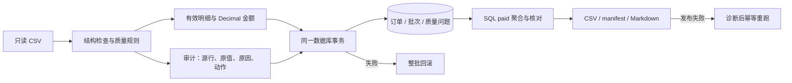

# E-Commerce Order Pipeline

Python / Pandas 单机订单 ETL：检查 CSV、隔离异常、精确计算金额、事务入库，再以 SQL 核对和输出报告。包含 SQLite 与 MySQL 适配，适合展示批处理的正确性、审计和失败恢复。

本目录是独立公开候选工程，不包含私人学习记录或原 Git 历史。工程与本轮拆分为 **Codex 辅助实现**，不宣称作者已独立掌握全部代码。许可证尚待所有者决定；当前未授予项目开源许可，见[发布决策](docs/RELEASE_DECISIONS.md)。

## 五分钟运行

准备 Python 3.12，在项目根目录执行（macOS / Linux）：

```bash
python3.12 -m venv .venv
.venv/bin/python -m pip install -r requirements.txt -c constraints-demo-py312.txt
.venv/bin/python -m scripts.demo_sqlite
```

无需 MySQL 或 Docker。每次新建独立 SQLite，运行完整 CLI、重跑、分析、报告重建及质量检查；核对十份产物哈希、SQL 金额、三表数量和输入保护。最后一行给出 `.local/demos/sqlite-*/run/report.md` 路径。

```text
演示通过：30 = 26 + 3 + 1；paid 66.00 元；重跑、SQL、输入保护一致。
```

[查看真实生成的报告](docs/sample-report.md)。本轮新建 demo-v1 虚构样本：30 行、26 接收、3 隔离、1 重复副本；11 条 paid 合计 **66.00 元**。这不是旧教学数据的 1223.70 元口径，规则未因换样本而改变。[数据来源与重建方法](data/README.md)。

## 业务流程



- 完全重复保留首条；同批相同订单编号但内容冲突全部隔离。非法数量、价格和状态隔离；空城市补「未知」，无效日期留空且保留订单金额。
- 单价使用 Decimal，数据库金额存整数分（MySQL BIGINT）；只统计 `paid`。Pandas 本批汇总与 SQL 全库汇总分别输出，不能在多批次后混为一谈。
- 唯一键 `order_id`；比较库中当前业务字段，未变值不写入，支持 A → B → A 恢复。订单、批次、问题记录同事务；数据库提交与文件发布分别处理，通过幂等重试恢复。

[架构与三表设计](docs/ARCHITECTURE.md) · [运行、MySQL 与 Docker](docs/RUNNING.md)

## 验证与性能

```bash
.venv/bin/python -m pip install -r requirements-dev.txt -c constraints-demo-py312.txt
.venv/bin/python -m pytest tests/v1 -q
.venv/bin/python -m ruff check src/order_pipeline scripts tests/v1
.venv/bin/python -m scripts.check_release
```

本快照的**实际测试数量、环境、命令和限制**见[独立验收证据](docs/VALIDATION.md)，不沿用原仓库的 164 项声明。覆盖质量边界、输入保护、真实 SQLite 事务／SQL、重跑、A/B/A、失败恢复、CLI 和发布文件完整性。MySQL 8.4.13 于 2026-10-31 在拆分前工程有历史真实验收；本快照未重新执行 live MySQL。Docker 构建已尝试，但 Docker Hub 鉴权请求超时，未成功构建或运行应用容器；Compose 只做配置校验，远端 GitHub Actions 未运行。

性能工具只接受带 synthetic 标记且哈希匹配的新数据；种子固定、每档新进程与新 SQLite、1000/10000/50000 行串行运行，单档超时 120 秒，升至 50000 行前检查峰值内存。512 MiB 为升级门槛，不是 OS 强制限额。

```bash
.venv/bin/python -m scripts.benchmark --sizes 1000 10000 50000 --label first-run --output .local/benchmarks
```

标签不可复用。阶段耗时与进程峰值的单位、环境和单次观测限制见[验收记录](docs/VALIDATION.md)。不将合成单机实验称为企业吞吐、线上收益或集群经验。

## 范围与归因

一行代表单商品订单；单机、单写者、最后成功加载生效；没有事件时间水位、并发写入或分布式事务。没有企业真实数据、线上用户或生产部署证据。Python 3.12/macOS 为本轮实测环境，Linux CI 矩阵与 Windows 未据此宣称通过。

- [源码来源及与私有工程的区别](docs/PROVENANCE.md)
- [第三方依赖许可](docs/THIRD_PARTY.md)
- [发布前决策](docs/RELEASE_DECISIONS.md)、[项目经历与本人复现要求](docs/PORTFOLIO.md)
- [逐文件来源映射](docs/SOURCE_MAP.json)、[公开文件 SHA-256 清单](SHA256SUMS.json)

推荐仓库名 `ecommerce-order-pipeline`，名称可用性未查询；尚未创建 GitHub 仓库或 push。
